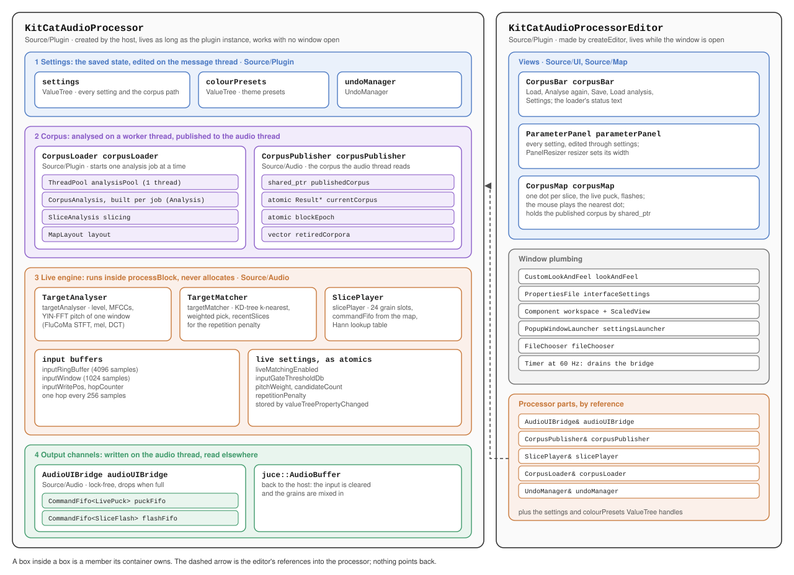
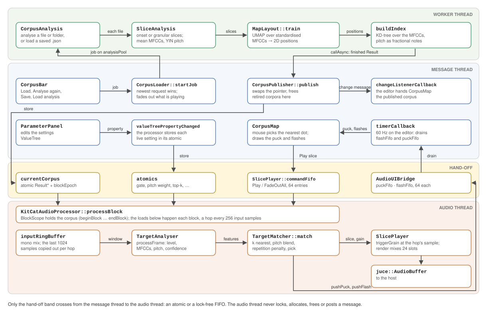

# Kit-Cat architecture

This is the technical companion to the [README](../README.md). It goes through the program from the top down. First come the two objects everything hangs from, then the layers inside each, then the classes inside each layer. The later sections cover how the parts talk across threads, what comes from FluCoMa, latency, which folders may depend on which, and the tests.

## 1. The two roots

Every object in the program is owned, directly or through a chain of members, by one of two classes in `Source/Plugin/`:

| Root | Created by | Lifetime | Owns |
|---|---|---|---|
| `KitCatAudioProcessor` | the host (or the standalone wrapper) | the whole plugin instance | everything the sound depends on: the settings, the corpus and its analysis, the live engine and the output channels |
| `KitCatAudioProcessorEditor` | `KitCatAudioProcessor::createEditor` | only while the window is open | the views: the corpus bar, the parameter panel, the map and the window plumbing |



*Figure 1. What owns what. A box inside a box is a member its container owns.*

The split follows lifetime. Closing the window destroys the editor and nothing else, so the processor holds whatever playback, saving and analysis need. This is why `CorpusLoader` and `undoManager` are processor members even though only the interface starts an analysis or an edit: a restored state starts an analysis with no editor open, and its corpus still reaches the audio thread.

References run from the editor into the processor and never back. The editor takes the processor parts it uses by reference in its constructor (`audioUIBridge`, `corpusPublisher`, `slicePlayer`, `corpusLoader`, `undoManager`) and copies the `settings` and `colourPresets` `ValueTree` handles. It learns about a finished analysis by listening to `CorpusLoader`'s change messages, and about the live engine by polling the bridge.

## 2. The processor

`KitCatAudioProcessor`'s members fall into four layers. Each layer reads the one above it and is read by the one below it.

| Layer | Members | Folder | Thread |
|---|---|---|---|
| 1. Settings | `settings`, `colourPresets`, `undoManager` | `Source/Plugin/` | message |
| 2. Corpus | `corpusLoader`, `corpusPublisher` | `Source/Plugin/`, `Source/Analysis/`, `Source/Audio/` | analysed on a worker, published on message, read on audio |
| 3. Live engine | `targetAnalyser`, `targetMatcher`, `slicePlayer`, the input buffers and the live-setting atomics | `Source/Audio/` | audio |
| 4. Output channels | `audioUIBridge`, the `AudioBuffer` | `Source/Audio/` | written on audio, read elsewhere |

### 2.1 Settings

The settings are the state that is saved with a project.

- **`settings`** is one `ValueTree` of type `KitCatState` holding every setting and the corpus path. Its keys are in `StateIdentifiers`. `ParameterPanel` edits it through `undoManager`.
- **`colourPresets`** holds the theme presets of ArsNovaUI's settings menu.
- `getStateInformation` writes `settings` with `colourPresets` as a child. `setStateInformation` copies the properties back, clears the undo history and calls `corpusLoader.analyse()`, so a reopened project analyses its corpus again from the saved path.

The processor is a `ValueTree::Listener` on `settings`. `valueTreePropertyChanged` stores each live setting in the atomic the audio thread reads: `liveMatchingEnabled`, `inputGateThresholdDb`, `pitchWeight`, `candidateCount`, `repetitionPenalty`, and `SlicePlayer`'s `fadeSeconds` and `lengthSeconds`. The analysis settings stay in the tree until the next analysis reads them.

### 2.2 Corpus

The audio thread cannot wait for an analysis, and it cannot read a corpus that is still being built. This layer analyses on a worker thread and hands the audio thread only finished corpora.

- **`CorpusLoader`** starts the jobs. `analyse`, `loadAnalysis` and `saveAnalysis` are what the corpus bar calls. `startJob` reads the analysis settings into a fresh `CorpusAnalysis` (`readSettings`), fades out whatever is playing, cancels the job in progress and queues the new one on its one-thread `analysisPool`. When a job finishes, `MessageManager::callAsync` brings the `Result` back to the message thread. Only the newest request (`latestRequest`) is published; an older one that finishes late is dropped. `statusText` and `state` (`Idle` / `Analysing`) are what the corpus bar and the map show.
- **`CorpusAnalysis`** turns a file or a folder into a `Result`, in the order `analyse` runs it:
  1. `SliceAnalysis` reads each file to mono at 44.1 kHz and cuts it into slices, at detected onsets or as 60 ms grains every 30 ms. Each slice keeps its mean MFCCs and a confidence-weighted YIN pitch.
  2. `layOutMap` standardises the MFCCs and runs `MapLayout::train`, a UMAP layout, to give each slice a 2D position.
  3. `buildIndex` builds a KD-tree over the standardised MFCCs and stores each slice's pitch as a fractional MIDI note.

  `load` reads a saved analysis instead and runs `buildIndex` on it, and `save` writes one as JSON. `shouldStop` is checked between files, on every analysis frame, on every point of the UMAP neighbour graph and on every UMAP epoch, so closing Kit-Cat or starting a newer job waits only for the step in progress.
- **`CorpusPublisher`** owns the corpus the audio thread reads: `publishedCorpus` (the `shared_ptr` the message thread keeps) and `currentCorpus`, an atomic raw pointer to the same `Result`. `publish` stamps the new corpus with a `generation`, swaps both, and frees the old one. See *How the parts talk* for how it frees without ever making the audio thread free.

### 2.3 Live engine

The live engine runs entirely inside `processBlock`, which is declared `noexcept [[clang::nonblocking]]`:

- **The input buffers.** Each input sample is mixed to mono into `inputRingBuffer` (4096 samples). Every 256 samples (`targetHopSize`, one hop) the last 1024 (`targetWindowSize`) are copied into `inputWindow`.
- **`TargetAnalyser`** describes one window: level, MFCCs (FluCoMa's STFT, mel bands and DCT), and pitch with its confidence. The pitch step is a port of FluCoMa's `YINFFT` onto buffers allocated in `prepare`.
- **`TargetMatcher`** finds the *k* nearest slices in the corpus's KD-tree. Distance is MFCC distance blended with pitch distance (`pitchWeight`), and slices in `recentSlices` are penalised (`repetitionPenalty`). It picks one of the *k* at random, weighted by closeness.
- **`SlicePlayer`** plays the corpus audio: 24 `Slot`s that are either grains from the live engine or slices from the map. `triggerGrain` starts a Hann-windowed grain at the sample where the hop ended. `push` queues a `Command` (`Play`, `FadeOutAll`) from the message thread into its `commandFifo`, which `render` takes at the top of each block. When the corpus's `generation` changes, `render` clears every slot, so no slot reads a corpus that has gone.

One block, in order:

1. `CorpusPublisher::BlockScope` calls `beginBlock()`, which makes `blockEpoch` odd and loads the current corpus. Its destructor calls `endBlock()`.
2. With live matching on, each input sample goes into the ring buffer, and each completed hop runs `TargetAnalyser::processFrame`.
3. Above the input gate, `TargetMatcher::match` picks a slice, `SlicePlayer::triggerGrain` starts it at a level that follows the input's, and the bridge gets a flash for the slice and a puck at its map position. Below the gate, the bridge gets an inactive puck.
4. The buffer is cleared, so nothing of the input is heard, and `SlicePlayer::render` mixes every playing slot into it.

### 2.4 Output channels

- **The `AudioBuffer`** goes back to the host, holding only the grains and slices.
- **`AudioUIBridge`** is the only channel from audio to screen: two `CommandFifo`s of plain structs, `puckFifo` (`LivePuck`: position, level, active) and `flashFifo` (`SliceFlash`). A `CommandFifo` is a single-producer, single-consumer `juce::AbstractFifo` of 64 entries. When it is full it drops the command and sets `overflowed` instead of blocking.

## 3. The editor

`KitCatAudioProcessorEditor` builds its children in its constructor and sets its `lookAndFeel` on itself, so JUCE hands it to every child:

| Member | Folder | Job |
|---|---|---|
| `corpusBar` (`CorpusBar`) | `Source/UI/` | Load, Analyse again, Save, Load analysis, Settings, and the loader's status text |
| `parameterPanel` (`ParameterPanel`) | `Source/UI/` | every setting, in three sections, with a `PanelResizer` for its width |
| `corpusMap` (`CorpusMap`) | `Source/Map/` | the map: one dot per slice, the live puck and the flashes, and mouse playback |
| `lookAndFeel`, `interfaceSettings`, `workspace`, `scaledView`, `settingsLauncher`, `fileChooser` | ArsNovaUI, JUCE | theme, the per-computer interface settings, interface zoom, the settings pop-up, file dialogs |

The editor is a `ChangeListener` on `CorpusLoader` and a `Timer` at 60 Hz. `changeListenerCallback` hands the map `corpusPublisher.publishedCorpus` and freezes the map while an analysis runs. `timerCallback` drains both bridge FIFOs into the map.

### 3.1 `CorpusMap`

The map is a component that holds the published corpus by `shared_ptr`, so the corpus it draws lives as long as it does. Each slice is a dot, coloured by its position. `setLivePuck` and `flashSlice` take what the timer drained, and `updateFlashes` fades the flashes each frame. Moving or dragging the mouse plays the nearest dot through `onSlicePicked`, which the editor connects to `SlicePlayer::push`. Scroll pans, pinch or Shift+scroll zooms around the cursor (`viewTransform`, `zoom`), and a double-click shows the whole map. `state` is `Frozen` while an analysis runs: the dots turn grey, a spinner shows, and the mouse plays nothing.

### 3.2 Bars and panels

`CorpusBar` and `ParameterPanel` derive from ArsNovaUI's `Bar` and are built from its generic components (`ButtonPane`, `ItemSelector`, `LabeledEditor`, `CaptionLabel`). `CorpusBar` holds only callbacks (`onLoad`, `onAnalyse`, `onSaveAnalysis`, `onLoadAnalysis`, `onSettings`), which the editor assigns. `ParameterPanel` writes straight into `settings`, and listens to it so its selectors follow an undo or a restored state.

### 3.3 ArsNovaUI

The theme (`Theme`, `CustomLookAndFeel`), `ScaledView`, `Bar`, the settings menu and the generic components come from the [ArsNovaUI](https://github.com/EliBaumgardner/ArsNovaUI) submodule, in `namespace ArsNovaUI`. The interface zoom and theme colour are saved in `interfaceSettings`, on this computer rather than in the project.

## 4. How the parts talk

The threads never call into each other. Each crossing goes through an atomic, a lock-free FIFO, or `callAsync` from the worker thread, shown as the bands in figure 2.



*Figure 2. The paths between the worker thread, the message thread and the audio thread.*

1. **Load → analysis.** `CorpusBar` calls `CorpusLoader`, whose `startJob` queues the job on `analysisPool`. The worker runs `CorpusAnalysis` through `SliceAnalysis`, `MapLayout::train` and `buildIndex`, then posts the finished `Result` back with `callAsync`.
2. **Analysis → sound.** On the message thread, `CorpusPublisher::publish` stores the new `currentCorpus`, and the next block's `beginBlock` loads it. `CorpusLoader`'s change message tells the editor, which hands the map the same corpus.
3. **Settings → sound.** `ParameterPanel` writes `settings`. The processor's `valueTreePropertyChanged` stores each live setting in its atomic, and `processBlock` loads them each block.
4. **Map → sound.** The mouse on `CorpusMap` calls `SlicePlayer::push`, a `Play` command into `commandFifo`. `CorpusLoader` pushes `FadeOutAll` the same way when a job starts.
5. **Sound → screen.** `processBlock` pushes a puck and a flash into `AudioUIBridge` for each grain. The editor's 60 Hz timer drains both FIFOs into `CorpusMap`. With no editor open, the FIFOs fill and drop.

Memory is reclaimed without the audio thread freeing anything. `blockEpoch` is odd while a block runs. When `publish` replaces a corpus it reads the epoch: if it is even, the old corpus is freed on the spot; if it is odd, it is parked in `retiredCorpora` until a later publish sees the epoch has moved on. Both sides are `seq_cst`, which rules out a block loading the old pointer after the publisher read an even epoch. A RealtimeSanitizer build enforces this (section 8).

## 5. What FluCoMa does, and what is written here

| From [FluCoMa](https://www.flucoma.org/) (`flucoma-core`, BSD-3) | Written for Kit-Cat |
|---|---|
| STFT, mel filterbank, DCT (MFCCs) | Live analysis: ring buffer, hop scheduling, input gate |
| Onset detection and segmentation | The live YIN-FFT pitch step: a port of FluCoMa's `YINFFT` onto buffers allocated ahead of time (FluCoMa's own version allocates on every frame), tested identical to it |
| YIN-FFT pitch (offline analysis) | KD-tree build and an allocation-free k-nearest search that stays exact under the blended timbre/pitch distance |
| Standardisation, normalisation | Matching distance, weighted random choice among the best *k*, repetition penalty |
| KD-tree and spectral embedding inside the UMAP layout | The UMAP layout's training: a port of FluCoMa's `UMAP::train` that can be stopped part-way (FluCoMa's runs to the end once started), tested identical to it |
| | Grain player: overlapping slots, interpolated playback, Hann window from a lookup table, sample-accurate starts |
| | Epoch-guarded corpus publisher, lock-free audio-to-UI bridge |
| | Corpus loading, analysis save and load (JSON), the interface and the map |

## 6. Latency

These figures are measured by `LiveMatchingTests.cpp`, which feeds a tone into `processBlock` and finds the first output sample.

- **Trigger:** a grain starts at the end of the first hop after the input's onset. That is 0–256 samples later: at most 5.8 ms at 44.1 kHz, 2.9 ms on average. In the test, the onset fell 44 samples into a hop and the grain started 212 samples after it.
- **Host:** add the audio interface's input and output buffers. The plugin reports no extra latency to the host.
- **Matching:** the first grain is chosen from a 1024-sample window (23 ms) that still holds mostly what came before the onset. The next three hops see more and more of the new sound.
- **Envelope:** a grain is Hann-windowed over its whole length, so it reaches full level halfway through. For a 60 ms grain that is 30 ms after it starts, and it is the largest part of the latency you hear.

## 7. Folders and dependency direction

| Folder | Layer | Includes from |
|---|---|---|
| `Source/Analysis/` | `SliceAnalysis`, `MapLayout`, `CorpusAnalysis` | nothing (JUCE and FluCoMa only) |
| `Source/Audio/` | the live engine, the publisher and the bridge | `Analysis` |
| `Source/Map/` | `CorpusMap` | `Analysis` |
| `Source/UI/` | `CorpusBar`, `ParameterPanel` | nothing |
| `Source/Plugin/` | the two roots, `CorpusLoader`, `StateIdentifiers` | everything |
| `Source/Probe/` | `KitCatProbe`, a command-line run of the analysis | `Analysis` |

The lower rows depend on the upper ones. The one exception is `ParameterPanel.cpp`, which includes `Plugin/StateIdentifiers.h` for the settings keys. `KitCatProbe` compiles only `Source/Analysis/` and `ProbeMain.cpp`, so it runs an analysis from the command line without the plugin.

## 8. Tests

The tests use [Catch2](https://github.com/catchorg/Catch2) v3 and live in `Tests/`. `TestCorpus` builds a synthetic corpus, so matching and playback can be tested without running the full analysis.

| Test | What it checks |
|---|---|
| `MatchingTests` | The KD-tree search returns the same slice as an exhaustive search over 2,000 slices, at pitch weights 0, 0.5 and 0.9. The exhaustive reference computes its distance on its own, from the formula. |
| `LiveMatchingTests` | A grain never starts before the input that triggered it, and always starts within one hop of it. |
| `TargetAnalyserTests` | Sines at 220, 440 and 880 Hz are read at the right level and nearest note. Silence gives no level and no note. The live pitch step matches FluCoMa's `YINFFT` on 200 frames of harmonic tones with noise. |
| `BridgeTests` | A producer thread pushes 200,000 commands through a `CommandFifo`. They arrive in order and untorn, and anything dropped is flagged. |
| `CorpusFileTests` | A saved analysis still loads after its whole corpus folder has moved. |
| `MapLayoutTests` | The ported UMAP training places 60 random points exactly where FluCoMa's `UMAP::train` does for the same seed, and returns no positions when asked to stop before, during or after building its neighbour graph. |
| `RealtimeTests` | 600 blocks of live matching, mouse playback, parameter changes and a corpus swap, run under RealtimeSanitizer. Any allocation, lock or blocking call in `processBlock` aborts the test with a stack trace. Built only with `KITCAT_REALTIME_SANITIZER`. |

```bash
cmake --build build --target KitCat_Tests
ctest --test-dir build --output-on-failure
```

The RealtimeSanitizer build needs upstream clang 20 or later, because Apple clang doesn't ship it. Use Homebrew's `llvm` in its own build directory:

```bash
cmake -B build-rtsan -G Ninja -DCMAKE_BUILD_TYPE=Debug \
  -DCMAKE_C_COMPILER=/opt/homebrew/opt/llvm/bin/clang \
  -DCMAKE_CXX_COMPILER=/opt/homebrew/opt/llvm/bin/clang++ \
  -DKITCAT_REALTIME_SANITIZER=ON
cmake --build build-rtsan --target KitCat_RealtimeTests && build-rtsan/KitCat_RealtimeTests
```

The interface and plugin-format behaviour are checked by hand in a host.
